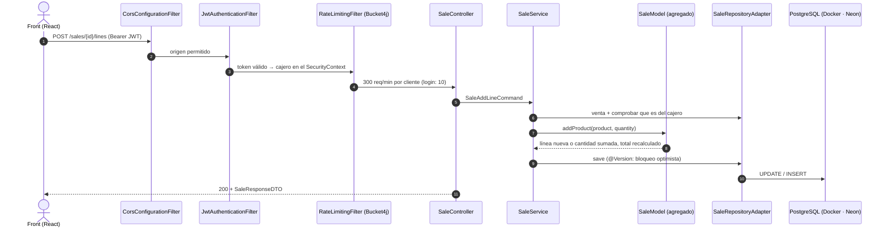

# 🧾 Classora TPV — Backend (Spring Boot)

[](https://github.com/DiegoVilla27/prueba-tecnica-classora-be/actions/workflows/ci-cd.yml)
[](https://openjdk.org/)
[](https://spring.io/projects/spring-boot)
[](https://neon.tech/)
[](https://flywaydb.org/)
[](https://jwt.io/)
[](https://pos-api-prod.onrender.com/api/v1/api-docs/swagger-ui.html)
[](https://render.com/)

API REST de la caja de supermercado de la prueba técnica de Classora: **cajeros autenticados con JWT**, **consulta de producto por código** y **gestión completa de la venta** (escanear, cambiar cantidad, quitar, cobrar y cancelar). Desplegada en `dev` y `prod` con CI/CD.

Arquitectura **hexagonal por features + DDD**, con el mismo estilo que [task-manager](https://github.com/DiegoVilla27/task-manager-system/tree/main/apps/task-manager).

> Frontend: `prueba-tecnica-classora-fe` (React · Vercel).

---

## 🌐 Entornos

| Entorno | API | Swagger UI | Base de datos | Cajero demo |
| :-- | :-- | :-- | :-- | :-- |
| **local** | `http://localhost:8080/api/v1` | [Swagger local](http://localhost:8080/api/v1/api-docs/swagger-ui.html) | `global_postgres` (`localhost:5432/pos_db`) | `cajero@pos.local` / `cajero1234` |
| **docker** | `http://localhost:8080/api/v1` | [Swagger docker](http://localhost:8080/api/v1/api-docs/swagger-ui.html) | `global_postgres:5432/pos_db` | `cajero@pos.local` / `cajero1234` |
| **dev** | `https://pos-api-dev-k0y9.onrender.com/api/v1` | [Swagger dev](https://pos-api-dev-k0y9.onrender.com/api/v1/api-docs/swagger-ui.html) | Neon, rama `dev` | `cajero@pos.dev` / `cajero1234` |
| **prod** | `https://pos-api-prod.onrender.com/api/v1` | [Swagger prod](https://pos-api-prod.onrender.com/api/v1/api-docs/swagger-ui.html) | Neon, rama `prod` | `cajero@pos.prod` / `cajero1234` |

> ⏳ dev y prod usan el plan gratuito de Render: tras 15 min sin uso el servicio se duerme y la primera petición tarda unos 50 s.

**Probarlo en Swagger:** `POST /auth/login` con el cajero demo → copia el `accessToken` → **Authorize** → `POST /sales` → `POST /sales/{id}/lines` con `{ "code": "8410001000011", "quantity": 1 }`.

---

## 🛒 Qué hace la API

Una **venta** es el ticket de un cliente. Cada **línea** es un producto distinto dentro del ticket, con su precio congelado al escanear, su cantidad y su subtotal. Escanear dos veces el mismo código suma cantidad en la misma línea. El total y el número de artículos los calcula siempre el servidor.

| Método | Ruta | Qué hace |
| :-- | :-- | :-- |
| `POST` | `/auth/login` · `/auth/refresh` | Login del cajero y renovación del token |
| `GET` | `/users/me` | Cajero autenticado |
| `GET` | `/products/{code}` ⭐ | Producto por código (404 si no existe) |
| `POST` | `/sales` | Abre una venta (una abierta por cajero) |
| `GET` | `/sales/current` · `/sales/{id}` | Venta abierta del cajero (para recuperar tras recargar) · venta por id |
| `POST` | `/sales/{id}/lines` | Escanea un producto: crea la línea o suma cantidad |
| `PATCH` | `/sales/{id}/lines/{lineId}` | Cambia la cantidad de una línea (1–999) |
| `DELETE` | `/sales/{id}/lines/{lineId}` | Quita una línea |
| `PATCH` | `/sales/{id}/complete` · `/sales/{id}/cancel` | Cobra (no si está vacía) · cancela |

Errores con un único formato `{ timestamp, status, error, message, errors[] }`: 400 validación · 401 sin sesión · 403 venta de otro cajero · 404 no existe · 409 venta cerrada, ya abierta o modificada a la vez · 422 regla de negocio · 429 demasiadas peticiones. Detalle completo en [`docs/04-api.md`](docs/04-api.md).

---

## 🏗️ Arquitectura



- **Hexagonal por features:** `domain` (sin Spring ni JPA) ← `application` (casos de uso y puertos) ← `infrastructure` (HTTP, JPA, mappers).
- **DDD:** `SaleModel` es el agregado raíz; `SaleLine` solo cambia a través de él; `Quantity` y `SaleStatus` son value objects. Las reglas (una línea por producto, 1–999, no cobrar vacía, no tocar una venta cerrada) viven en el dominio.
- **Concurrencia:** `@Version` + constraints con nombre (`ux_sales_one_open_per_cashier`, `uk_sale_lines_sale_product`) traducidos a 409; nunca 500 ni unidades perdidas.
- **Seguridad:** JWT doble token (acceso 1 h, refresco 7 días) con claves distintas, sin roles (todo usuario es cajero), propiedad de la venta, Bucket4j y CORS por entorno.
- **Persistencia:** el esquema lo define Flyway (`V1__init.sql`, `V2__seed_products.sql` con 12 productos); Hibernate solo valida (`ddl-auto=validate`).

```text
src/main/java/com/diegovilla/pos/
├── PosApplication.java
├── core/
│   ├── errors/          # ErrorResponseDTO, ApiException, handlers, traductor de constraints
│   ├── openapi/         # OpenApiConfig + respuestas comunes
│   ├── security/        # SecurityConfig, cors/, jwt/, ratelimit/
│   └── seeders/         # cajero demo por entorno
├── features/
│   ├── auth/            # login, refresh
│   ├── user/            # cajero, /users/me
│   ├── product/         # catálogo, GET /products/{code}
│   └── sale/            # agregado de la venta y sus 8 endpoints
│       ├── domain/          model/ · valueobjects/ · exceptions/
│       ├── application/     commands/ · ports/ · services/
│       └── infrastructure/  controllers/ · docs/ · dto/ · mappers/ · entity/ · repository/ · adapters/ · exceptions/
└── utils/
```

---

## ⚙️ Perfiles y configuración

Toda la configuración está en `src/main/resources/application.properties` (común) + `application-<perfil>.properties`, igual que task-manager.

| Perfil | Base de datos | Valores sensibles |
| :-- | :-- | :-- |
| `local` (por defecto) | `jdbc:postgresql://localhost:5432/pos_db` | En el fichero (solo desarrollo) |
| `docker` | `jdbc:postgresql://global_postgres:5432/pos_db` | En el fichero (solo desarrollo) |
| `dev` / `prod` | Neon (`jdbc:postgresql://ep-***.neon.tech/neondb?sslmode=require`) | `${VARIABLE}` resueltas con las variables de entorno de Render |

Variables de Render: `SPRING_PROFILES_ACTIVE`, `DATABASE_URL`, `DATABASE_USERNAME`, `DATABASE_PASSWORD`, `JWT_SECRET`, `JWT_REFRESH_SECRET`, `SEED_CASHIER_PASSWORD`, `CORS_ALLOWED_ORIGINS`. Ver [`docs/07-despliegue.md`](docs/07-despliegue.md).

---

## ▶️ Ejecutar en local

Requisitos: JDK 17 o superior, Docker y la infraestructura compartida (`~/Desktop/shared-network`, contenedor `global_postgres`).

```bash
# 1. Base de datos (una vez)
docker compose -f ~/Desktop/shared-network/docker-compose.yml up -d postgres
docker exec global_postgres psql -U user -d postgres -c "CREATE DATABASE pos_db;"

# 2a. API en la máquina (perfil local) → http://localhost:8080/api/v1
./mvnw spring-boot:run

# 2b. o API en contenedor (perfil docker, red shared-network)
docker compose up --build -d
```

Health: `http://localhost:8080/api/v1/actuator/health`.

## 🧪 Calidad y tests

```bash
./mvnw test              # 107 tests unitarios (dominio sin mocks; service, controller y adapter con Mockito)
./mvnw verify            # + 17 tests de integración con Testcontainers, Spotless y JaCoCo (≥ 80 % en domain/application)
./mvnw spotless:apply    # formatear (Google Java Format AOSP)
```

---

## 🚀 CI/CD ([`ci-cd.yml`](.github/workflows/ci-cd.yml))

```
feature/* ──PR──▶ dev ──PR──▶ main
                   │            │
                   ▼            ▼
              Render dev   Render prod
```

| Job | Qué hace |
| :-- | :-- |
| ⚡ Static checks | Solo PR a `main` desde `dev` · Spotless · compilación |
| 🧪 Unit tests | `./mvnw test` + cobertura JaCoCo ≥ 80 % (artefacto con el informe) |
| 🔗 Integration tests | `*IT` con Testcontainers (PostgreSQL real) |
| 📦 Build | `docker build` con el mismo `Dockerfile` que usa Render |
| 🛡️ Quality gate | Falla si cualquiera de los anteriores falla |
| 🚀 Deploy | Push a `dev` o `main` → deploy hook de Render del entorno |

`main` y `dev` están protegidas: solo se entra por PR con el quality gate en verde. Commits con [Conventional Commits](https://www.conventionalcommits.org/).

---

## 📚 Documentación

| Doc | Contenido |
| :-- | :-- |
| [`CLAUDE.md`](CLAUDE.md) | Reglas del proyecto: alcance, stack, arquitectura, convenciones, git |
| [`AI_LOG.md`](AI_LOG.md) | Registro cronológico del uso de IA |
| [`docs/01-negocio-y-dominio.md`](docs/01-negocio-y-dominio.md) | Requisitos, bounded contexts, agregado `Sale`, reglas de negocio |
| [`docs/02-casos-de-uso.md`](docs/02-casos-de-uso.md) | Casos de uso (el alcance completo) |
| [`docs/03-arquitectura.md`](docs/03-arquitectura.md) | Paquetes, agregado, Flyway, decisiones (ADRs) |
| [`docs/04-api.md`](docs/04-api.md) | Endpoints, contratos, errores, OpenAPI |
| [`docs/05-seguridad.md`](docs/05-seguridad.md) | JWT, propiedad de la venta, rate limiting, CORS, secretos |
| [`docs/06-testing.md`](docs/06-testing.md) | Estrategia de tests |
| [`docs/07-despliegue.md`](docs/07-despliegue.md) | Entornos, Docker, Render, Neon, CI/CD |
| [`docs/08-roadmap.md`](docs/08-roadmap.md) | Hitos y lo que queda fuera de alcance |

## 🤖 Uso de IA

El proyecto se ha desarrollado con **Claude Code**. Cada petición, lo que hizo la IA y las correcciones humanas están en [`AI_LOG.md`](AI_LOG.md); las reglas que sigue el agente, en [`CLAUDE.md`](CLAUDE.md) y [`.claude/skills/`](.claude/skills/).
