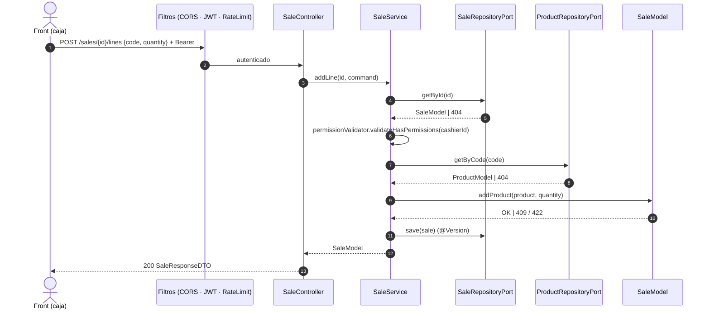

# 02 · Casos de uso (Backend)

Cada caso de uso = un método de un `*Service`. **Esta lista es el alcance completo.**

---

## Feature `auth`

### UC-A01 · Iniciar sesión
`POST /auth/login` `{ email, password }` → busca usuario → BCrypt → **200** `{ accessToken, refreshToken, tokenType, expiresIn }`.
Errores: 400 validación · **401** "Invalid credentials." (mensaje genérico, no revela si el email existe) · 429 (rate limit estricto).

### UC-A02 · Renovar sesión
`POST /auth/refresh` `{ refreshToken }` → valida firma, expiración y `type=refresh` → **200** nuevo par de tokens. Error 401.

> Sin registro público: en un TPV los usuarios los da de alta la empresa (aquí, el seeder).

## Feature `user`

### UC-U01 · Usuario autenticado
`GET /users/me` → **200** `{ id, firstName, lastName, email }`. El front lo muestra en la cabecera ("Cajero: Ana López").

---

## Feature `product`

### UC-P01 · Consultar producto por código ⭐
- `GET /products/{code}` · requiere sesión.
- `@Pattern` valida → `ProductService.getByCode` → `ProductRepositoryPort.getByCode` → **200** `ProductResponseDTO`.
- Errores: 400 formato · 401 sin token · **404** `Product not found.` · 429 · 500.

---

## Feature `sale`

Todos requieren sesión. Propiedad (RN-09: la venta es del cajero autenticado) validada en el service.

### UC-S01 · Abrir venta
`POST /sales` → `cashierId` del token → si ya tiene una `OPEN` → **409** (RN-08) → `SaleModel.create(cashierId)` → **201** + `Location`.

### UC-S02 · Recuperar venta abierta
`GET /sales/current` → **200** venta `OPEN` del cajero · **404** si no tiene. Al cargar la caja, el front hace `current` y, si da 404, `POST /sales`.

### UC-S03 · Consultar venta
`GET /sales/{id}` → 200 · 403 (venta de otro cajero) · 404.

### UC-S04 · Añadir producto (escanear)
`POST /sales/{id}/lines` `{ code, quantity }`
1. Cargar venta (404) y validar propiedad (403).
2. Cargar producto por código (404).
3. `sale.addProduct(product, quantity)`.
4. Guardar (`@Version`) → **200** venta completa.
Errores: 400 · 403 · 404 · 409 (no abierta / concurrencia) · 422 (cantidad).

### UC-S05 · Cambiar cantidad
`PATCH /sales/{id}/lines/{lineId}` `{ quantity }` → 200 venta · 404 · 409 · 422.

### UC-S06 · Eliminar línea
`DELETE /sales/{id}/lines/{lineId}` → **200** venta (el front necesita el total) · 404 · 409.

### UC-S07 · Finalizar venta
`PATCH /sales/{id}/complete` → 200 venta `COMPLETED` · 409 (ya cerrada) · 422 (vacía).

### UC-S08 · Cancelar venta
`PATCH /sales/{id}/cancel` → **204** · 403 · 404 · 409. El front a continuación abre una venta nueva.

### UC-S09 · Historial de ventas
`GET /sales?page=0&size=20` → 200 con una página de **resúmenes** de las ventas del cajero autenticado (abiertas, finalizadas y canceladas), de la más reciente a la más antigua: `itemCount`, `lineCount` y `total` se calculan en la misma consulta (agregados con `GROUP BY`, sin cargar líneas). El detalle de una venta es UC-S03. `size` 1–100 (400 si no). Solo las ventas propias: la consulta ya filtra por el cajero autenticado.

---

## Secuencia · UC-S04

