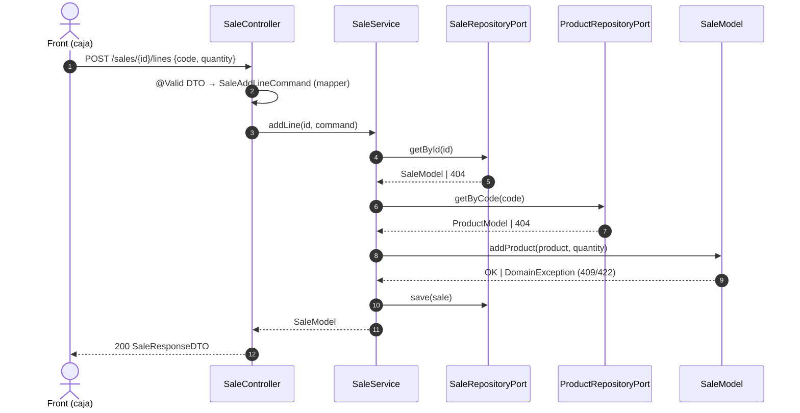

# 02 · Casos de uso (Backend)

Cada caso de uso = un método de un `*Service`. **Esta lista es el alcance completo**: lo que no está aquí no se implementa.

---

## Feature `product`

### UC-P01 · Consultar producto por código ⭐ (lo que pide el PDF)
- **Endpoint:** `GET /products/{code}`
- **Flujo:** `@Pattern` valida el formato → `ProductService.getByCode(code)` → `ProductRepositoryPort.getByCode` → 200 `ProductResponseDTO`.
- **Errores:** formato inválido → **400** con `errors[{ field, message }]` · no existe → **404** `Product not found.` · otro → **500** genérico.
- **Por qué 404 y no 200 con `null`:** semántica HTTP estándar; el front distingue "no existe" de "fallo técnico" solo por el status.
- **Implementación:** `ProductController.getByCode` + `@GetProductByCodeDocumentation`.

---

## Feature `sale`

### UC-S01 · Abrir venta
`POST /sales` → `SaleModel.create()` → **201** `SaleResponseDTO` (vacía, `OPEN`).

### UC-S02 · Consultar venta
`GET /sales/{id}` → 200 · 404 si no existe.

### UC-S03 · Añadir producto (escanear)
`POST /sales/{id}/lines` `{ "code": "8410001000011", "quantity": 1 }`
1. Cargar venta (404).
2. Cargar producto por código vía `ProductRepositoryPort` (404).
3. `sale.addProduct(product, quantity)` → suma o crea línea con snapshot de precio.
4. Guardar → **200** con la venta completa.
- **Errores:** 400 validación · 404 venta/producto · 409 venta no abierta · 422 cantidad fuera de rango.
- **Por qué devolver la venta entera:** el front reemplaza su estado con un único objeto; sin estados parciales.

### UC-S04 · Cambiar cantidad
`PATCH /sales/{id}/lines/{lineId}` `{ "quantity": 3 }` → `sale.changeQuantity` → 200 venta. Errores: 404 línea, 409, 422.

### UC-S05 · Eliminar línea
`DELETE /sales/{id}/lines/{lineId}` → `sale.removeLine` → **200** venta (no 204: el front necesita el total actualizado). Errores: 404, 409.

### UC-S06 · Finalizar venta
`PATCH /sales/{id}/complete` → `sale.complete()` → 200 venta `COMPLETED`. Errores: 404, 409 (ya finalizada), 422 (vacía).

---

## Secuencia · UC-S03

