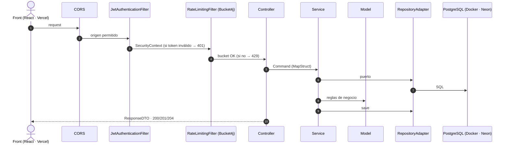

# 03 · Arquitectura y persistencia

> Reglas obligatorias en [`CLAUDE.md`](../CLAUDE.md). Aquí el **porqué** y el árbol completo.

## 1. ¿Por qué hexagonal + DDD?
- El valor está en las **reglas de la venta**: aisladas y testeables sin Spring ni BD.
- **Misma forma que task-manager** (incluido `core/security`), sin curva de aprendizaje.
- **Sin más capas de las necesarias**: ni CQRS, ni eventos, ni microservicios.

## 2. Flujo de una petición



## 3. Árbol completo

```
src/main/java/com/diegovilla/pos/
├── PosApplication.java
├── core/
│   ├── errors/
│   │   ├── dtos/{ErrorResponseDTO, FieldErrorDTO}.java
│   │   ├── exceptions/{ApiException, DomainException, ResourceNotFoundException}.java
│   │   ├── factories/{ErrorResponseFactory, FieldErrorFactory, InvalidFormatMessageResolver}.java
│   │   ├── handlers/{ApiExceptionHandler, SpringExceptionHandler}.java
│   │   └── translators/{DatabaseExceptionTranslator, DatabaseExceptionResolver}.java
│   ├── openapi/
│   │   ├── OpenApiConfig.java                       # servidores local/dev/prod + esquema Bearer
│   │   └── common/{BadRequest, Unauthorized, Forbidden, NotFound, Conflict,
│   │               UnprocessableEntity, TooManyRequests, InternalServerError}ApiResponse.java
│   ├── security/
│   │   ├── SecurityConfig.java
│   │   ├── cors/CorsConfigurationFilter.java
│   │   ├── jwt/{JwtService, JwtAuthenticationFilter, JwtProperties, JwtModel}.java
│   │   ├── jwt/ports/AuthenticatedUserProvider.java
│   │   ├── jwt/adapters/SpringSecurityUserProvider.java
│   │   ├── jwt/utils/PermissionValidator.java
│   │   └── ratelimit/{RateLimitingFilter, RateLimitService, RateLimitProperties}.java
│   └── seeders/DatabaseSeeder.java                  # usuarios demo desde env, idempotente
├── features/
│   ├── auth/
│   │   ├── application/{commands/{AuthLoginCommand, AuthRefreshCommand}, services/AuthService}
│   │   └── infrastructure/{controllers/AuthController, docs/{AuthLogin, AuthRefresh}Documentation,
│   │                       dto/request/{AuthLoginRequestDTO, AuthRefreshRequestDTO},
│   │                       dto/response/AuthResponseDTO, mappers/AuthDtoMapper}
│   ├── user/
│   │   ├── domain/{model/UserModel, exceptions/UserNotFoundException}
│   │   ├── application/{ports/{UserRepositoryPort, PasswordHasherPort}, services/UserService}
│   │   └── infrastructure/{controllers/UserController, docs/GetUserMeDocumentation,
│   │                       dto/response/UserMeResponseDTO, mappers/{UserDtoMapper, UserEntityMapper},
│   │                       entity/UserEntity, repository/UserJpaRepository,
│   │                       adapters/{UserRepositoryAdapter, BCryptPasswordHasherAdapter}}
│   ├── product/
│   │   ├── domain/{model/ProductModel, exceptions/ProductNotFoundException}
│   │   ├── application/{ports/ProductRepositoryPort, services/ProductService}
│   │   └── infrastructure/{controllers/ProductController, docs/GetProductByCodeDocumentation,
│   │                       dto/response/ProductResponseDTO, mappers/{ProductDtoMapper, ProductEntityMapper},
│   │                       entity/ProductEntity, repository/ProductJpaRepository, adapters/ProductRepositoryAdapter}
│   └── sale/
│       ├── domain/
│       │   ├── model/{SaleModel, SaleLine}.java
│       │   ├── valueobjects/{SaleStatus, Quantity}.java
│       │   └── exceptions/{SaleNotFoundException, SaleLineNotFoundException, SaleNotOpenException,
│       │                   EmptySaleException, InvalidQuantityException, OpenSaleAlreadyExistsException}.java
│       ├── application/
│       │   ├── commands/{SaleAddLineCommand, SaleUpdateLineCommand}.java
│       │   ├── ports/SaleRepositoryPort.java        # getById, getOpenByCashierId, save
│       │   └── services/SaleService.java            # open, getCurrent, getById, addLine, updateLine, removeLine, complete, cancel
│       └── infrastructure/
│           ├── controllers/SaleController.java
│           ├── docs/{OpenSale, GetCurrentSale, GetSale, AddSaleLine, UpdateSaleLine,
│           │         RemoveSaleLine, CompleteSale, CancelSale}Documentation.java
│           ├── dto/request/{SaleAddLineRequestDTO, SaleUpdateLineRequestDTO}.java
│           ├── dto/response/{SaleResponseDTO, SaleLineResponseDTO}.java
│           ├── mappers/{SaleDtoMapper, SaleEntityMapper}.java
│           ├── entity/{SaleEntity, SaleLineEntity}.java
│           ├── repository/SaleJpaRepository.java     # @EntityGraph("lines")
│           ├── adapters/SaleRepositoryAdapter.java
│           └── exceptions/SaleDatabaseExceptionResolver.java   # ux_sales_one_open_per_cashier → 409
└── utils/data/{StringUtils, ValidateDataUtils}.java

src/main/resources/
├── application.properties            # común: context-path, swagger, flyway, duraciones JWT, rate limit, actuator
├── application-local.properties      # localhost:5432/pos_db + secretos de desarrollo + cajero demo
├── application-docker.properties     # global_postgres:5432/pos_db (red shared-network) + ídem
├── application-dev.properties        # Neon rama dev: valores sensibles como ${VARIABLE} (Render)
├── application-prod.properties       # Neon rama prod: ídem
└── db/migration/
    ├── V1__init.sql                  # users, products, sales, sale_lines + constraints
    ├── V2__seed_products.sql         # primer catálogo (12 productos), reemplazado por V3
    └── V3__reset_data_and_reseed_products.sql  # vacía ventas, usuarios y productos; 20 productos EAN-13 (= fixtures MSW del front)
```

## 4. Agregado de ejemplo (guía de estilo)

```java
@Getter
public class SaleModel {
    private final UUID id;
    private final UUID cashierId;
    private SaleStatus status;
    private final List<SaleLine> lines;
    private final Long version;
    private final Instant createdAt;
    private Instant updatedAt;
    private Instant closedAt;

    public static SaleModel create(UUID cashierId) { ... OPEN, sin líneas ... }
    public static SaleModel reconstruct(...) { ... }

    public void addProduct(ProductModel product, int quantity) {
        ensureOpen();
        findLineByProduct(product.getId()).ifPresentOrElse(
                line -> line.increase(quantity),
                () -> lines.add(SaleLine.snapshotOf(product, quantity)));
        touch();
    }

    public void complete() {
        ensureOpen();
        if (lines.isEmpty()) throw new EmptySaleException();
        close(SaleStatus.COMPLETED);
    }

    public void cancel() {
        ensureOpen();
        close(SaleStatus.CANCELLED);
    }

    public BigDecimal total() {
        return lines.stream().map(SaleLine::subtotal).reduce(BigDecimal.ZERO, BigDecimal::add);
    }

    public List<SaleLine> getLines() { return List.copyOf(lines); }

    private void ensureOpen() {
        if (status != SaleStatus.OPEN) throw new SaleNotOpenException();
    }
}
```

## 5. Persistencia (Flyway `V1__init.sql`)

```sql
users       id UUID PK · first_name · last_name · email UNIQUE (uk_users_email) · password · created_at · updated_at
products    id UUID PK · code VARCHAR(14) UNIQUE (uk_products_code) · name VARCHAR(120) · price NUMERIC(12,2) CHECK ≥ 0 · created_at · updated_at
sales       id UUID PK · cashier_id FK → users · status VARCHAR(20) · version BIGINT · created_at · updated_at · closed_at
            UNIQUE INDEX ux_sales_one_open_per_cashier ON sales(cashier_id) WHERE status = 'OPEN'   -- RN-08
sale_lines  id UUID PK · sale_id FK → sales ON DELETE CASCADE · product_id FK → products
            product_code · product_name · unit_price NUMERIC(12,2)   -- snapshot (RN-04)
            quantity INT CHECK (quantity BETWEEN 1 AND 999) · position INT
            UNIQUE (sale_id, product_id) (uk_sale_lines_sale_product)                              -- RN-01
```
- `SaleEntity` `@OneToMany(mappedBy = "sale", cascade = ALL, orphanRemoval = true) @OrderBy("position")`, `@Version`.
- `spring.jpa.hibernate.ddl-auto=validate` en todos los perfiles: el esquema es de Flyway.
- `DatabaseSeeder` (todos los perfiles, idempotente): crea **un cajero** si no existe con `seed.cashier.first-name`, `last-name`, `email` y `password` (hash BCrypt) de `application-<perfil>.properties`. No va en Flyway para no versionar contraseñas.

## 6. Decisiones (ADRs)

| # | Decisión | Descartado | Motivo |
|---|---|---|---|
| ADR-01 | Hexagonal por features, estilo task-manager | Capas clásicas | Aislar dominio; consistencia |
| ADR-02 | `SaleLine` dentro del agregado | Repositorio de líneas | Las reglas abarcan toda la venta |
| ADR-03 | Endpoints de comando por línea, cliente envía código + cantidad | `PUT` del carrito / precio desde cliente | Intención explícita; el servidor fija el precio |
| ADR-04 | JWT doble token (copiado de task-manager), **sin roles** | Sesión con cookie; RBAC | API stateless desde otro dominio (Vercel); el enunciado solo tiene cajeros |
| ADR-05 | Usuarios sembrados, sin registro | `/auth/register` | En un TPV no se auto-registran cajeros |
| ADR-06 | Flyway + `validate` | `ddl-auto=update` | Hay BD de producción |
| ADR-07 | `@Version` | Bloqueo pesimista | Conflictos raros; respuesta 409 clara |
| ADR-08 | `ErrorResponseDTO` de task-manager | `ProblemDetail` | Consistencia con el front |
| ADR-09 | Secretos solo por entorno | Properties en el repo | En task-manager hay credenciales commiteadas: aquí no se repite |
| ADR-10 | Sin caché, sin CRUD de catálogo, sin informes | — | Ningún caso de uso lo pide (ver `08-roadmap.md`) |
